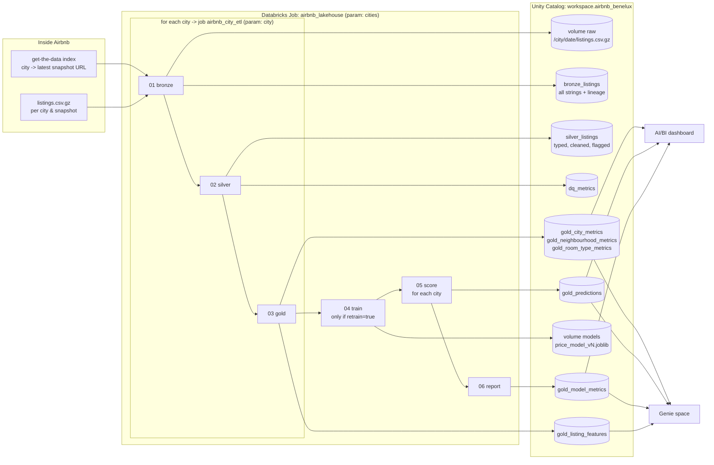

# Solution architecture

## Layers

| layer | object | grain | purpose |
|---|---|---|---|
| landing | volume `raw`: `/<city>/<snapshot_date>/listings.csv.gz` | file | Immutable copy of exactly what was downloaded. Reruns skip the download; if the cluster has no internet, a file can be uploaded here by hand. |
| **bronze** | `bronze_listings` (partition `city`) | listing x snapshot | The CSV as published: every column a string, plus `city`, `snapshot_date`, `source_file`, `ingested_at`. Schema merge on, because snapshots differ. |
| **silver** | `silver_listings` (partition `city`) | listing | Column contract, `try_cast` typing, parsed price/booleans/dates/amenities, bathrooms from text, de-duplicated on `id`, flags `price_status`, `is_long_stay`, `is_active`. Leaky `price_quote_*` columns are not carried over. |
| silver | `dq_metrics` | city x metric | Rows in, rows dropped per reason, price-status counts, missing optional columns. Nothing disappears silently. |
| **gold** | `gold_listing_features` | listing | Leakage-free model features, `dist_centre_km`, deterministic `split` (xxhash64(id) mod 100 < 20 -> test). |
| gold | `gold_city_metrics`, `gold_neighbourhood_metrics`, `gold_room_type_metrics` | city / neighbourhood / room type | Dashboard and Genie metrics (listings, hosts, median price, availability, ratings, mix). |
| gold | `gold_predictions` (slice city x model_version) | listing x model version | Predicted price, baseline price, error, for every listing, including unpriced ones (suggested price). |
| gold | `gold_model_metrics` | model version x city | MAE of the model and the baseline on the honest evaluation set: test split for training cities, all listings for new cities. |
| model store | volume `models`: `price_model_<version>.joblib` + `.json` | version | Immutable: a version can't be overwritten. Scoring a new city with `v1` really uses the week-1 model. Also logged to MLflow. |

## Parameterisation

* There is one code path: the `airbnb_lakehouse` Python package in `src/`. The notebooks only parse widgets and call it, and the same
  functions run locally (`scripts/run_local.py`, Parquet instead of Delta) for development and tests.
* **The city is the only input.** `01_bronze` resolves `city -> latest snapshot URL` from the Inside Airbnb index page, so no per-city config
  exists. A new city is just another value in the `cities` job parameter.
* Every per-city write overwrites only that city's partition (`replaceWhere city = ...`). Runs are idempotent, and cities run in parallel
  (`for_each_task`, concurrency 2) without touching each other.
* `retrain=false` + `model_version=v1` scores a new city with the frozen model. `retrain=true` + a new version trains a new model.

## Why these choices

* **Medallion**: bronze lets us rerun silver without downloading again, and keeps the evidence when a new snapshot breaks parsing.
  Silver holds every row, flags included, so the dashboard counts the whole supply. Gold holds only consumer-shaped tables.
* **scikit-learn on the driver, not Spark ML**: there are fewer than 10k rows per city. Spark is used where it helps (reading the CSV,
  typing, per-city partitions in Delta), and sklearn gives `TargetEncoder` cross-fitting and gradient boosting with native NaN handling.
* **Free Edition**: only serverless compute and the Serverless Starter Warehouse; no clusters, no paid features, so it costs nothing.
